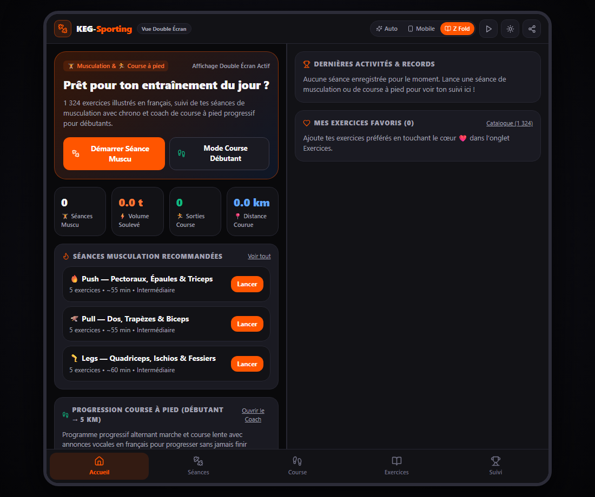
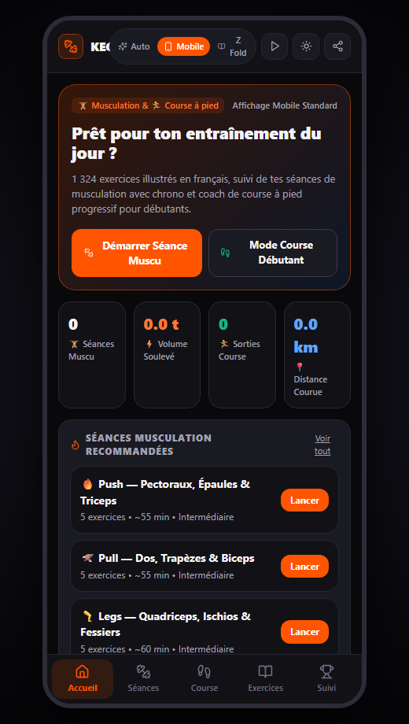
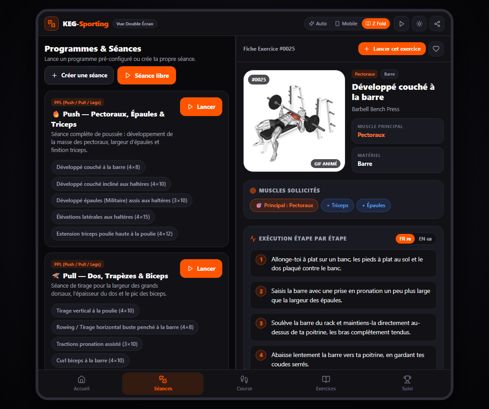
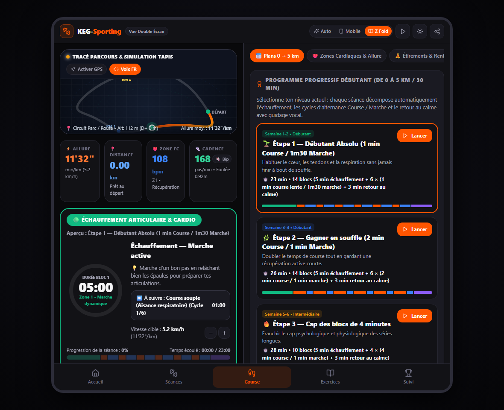
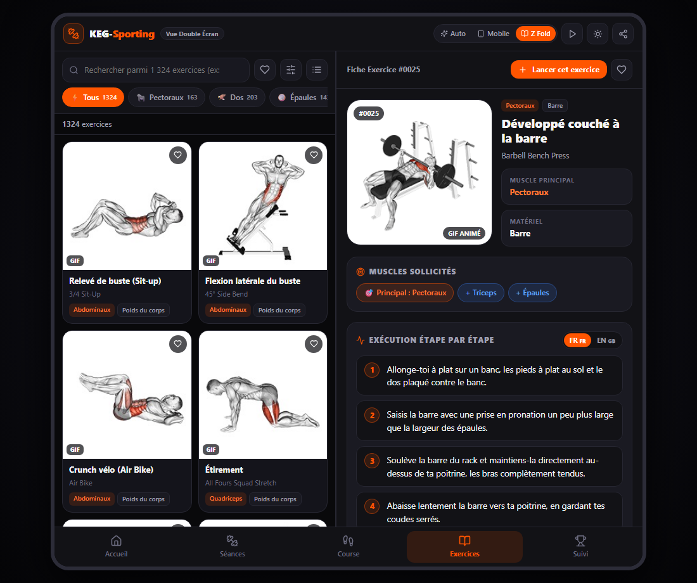

# 🏋️‍♂️🏃‍♂️ KEG-Sporting — Musculation & Course à Pied

**KEG-Sporting** est une application web progressive (**PWA**) complète dédiée à la **musculation** (catalogue de **1 324 exercices en français** avec GIFs animés, programmes, suivi de séances en direct avec chronomètre de repos) et à la **course à pied pour débutants** (séances progressives alternant marche et course avec coach vocal en français et suivi GPS).

Elle est conçue pour fonctionner :
- 📱 **Sur tous les smartphones classiques** (iPhone, Samsung Galaxy S, Pixel, Xiaomi, etc.) avec une interface mobile ergonomique à un seul écran et une barre de navigation inférieure à 5 onglets.
- 📖 **Sur les téléphones pliables (Samsung Galaxy Z Fold 5) & tablettes** grâce à une détection automatique qui bascule l'application en **mode double écran côte-à-côte (Split-View)** dès que le téléphone est déplié.

---

## 📸 Aperçu de l'interface (`/screenshot`)

### 1. Tableau de bord — Mode Double Écran (Galaxy Z Fold 5 déplié / Tablette)


### 2. Interface Smartphone Classique (Tous téléphones non-pliables & Z Fold plié)
<p align="center">
  
</p>

### 3. Programmes & Séances de Musculation en direct


### 4. Coach Course à Pied Débutant (0 → 5 km / 30 min en continu)


### 5. Encyclopédie des 1 324 Exercices en Français avec GIFs animés


---

## ✨ Fonctionnalités principales

- **🏠 Accueil & Tableau de bord :** Suivi du nombre de séances de musculation, du tonnage total soulevé, des sorties de course à pied et des kilomètres parcourus.
- **🏋️ Séances de Musculation :**
  - **5 programmes inclus** (*Push*, *Pull*, *Legs*, *Full Body*, *Abdos & Gainage sans matériel*) + **Créateur de séances personnalisées**.
  - **Suivi en salle en direct :** validation des séries (`Poids kg`, `Répétitions`, bouton `✓`), **chronomètre de repos automatique** avec signal sonore et vibration, et ajout d'exercices à la volée.
- **🏃 Mode Course à Pied Débutant :**
  - **6 séances progressives** basées sur l'alternance **Course lente / Marche active** (de *1 min course / 1m30 marche* jusqu'à *30 min en continu / 5 km* + *Fractionné 30s/30s*) et mode **Course Libre**.
  - **Coach vocal en français** (annonce à voix haute les changements de phase) + **suivi GPS réel** ou estimé.
  - **Conseils débutant** (règle de l'aisance respiratoire, cadence, régularité) et **Calculateur d'allure** (`min/km` ↔ `km/h`).
- **📚 Catalogue de 1 324 Exercices en Français :**
  - Recherche instantanée bilingue (FR / EN) insensible aux accents, filtres par groupe musculaire, muscle ciblé et équipement, système de favoris ❤️ et instructions étape par étape en français.
- **📊 Suivi, Records & Outils Salle :**
  - Historique complet des entraînements, détection automatique des **Records Personnels (PRs & 1RM)**, **Calculateur de 1RM** et **Calculateur de disques** pour barre olympique (20 kg).

---

## 🚀 Installation sur Téléphone (Fichier `.APK` direct) ou sur PC

### 📱 Option 1 — Installer directement le fichier `KEG-Sporting.apk` sur Android (Recommandé)
Aucune installation sur PC n'est requise ! L'APK embarque les **1 324 exercices en français, toutes les photos et tous les GIFs** pour fonctionner 100 % hors-ligne :

1. Depuis votre téléphone Android (**Samsung Galaxy Z Fold 5** ou **n'importe quel smartphone Android**), cliquez sur le lien de téléchargement direct :
   👉 **[Télécharger `KEG-Sporting.apk` (Dernière Release GitHub)](https://github.com/KarimEG45/keg-sporting/releases/latest/download/KEG-Sporting.apk)** *(ou rendez-vous dans l'onglet **[Releases](https://github.com/KarimEG45/keg-sporting/releases)** du dépôt).*
2. Ouvrez le fichier **`KEG-Sporting.apk`** téléchargé sur votre téléphone.
3. Si Android le demande, autorisez *« Installer des applications inconnues »*, puis appuyez sur **Installer**.

---

### 💻 Option 2 — Lancer le projet sur PC (Mode Développement)

#### Prérequis
- [Node.js](https://nodejs.org/) (version 18 ou supérieure)
- Git

#### 1. Cloner le dépôt et installer les dépendances
```bash
git clone https://github.com/KarimEG45/keg-sporting.git
cd keg-sporting
npm install
```

#### 2. Lancer l'application sur PC
```bash
npm run dev
```
*(Sous Windows, vous pouvez également double-cliquer directement sur le fichier `lancer-app.bat`)*

Ouvrez ensuite votre navigateur sur : **http://localhost:5173/**

---

## 🙏 Crédits & Source des Photos / GIFs

> **Attribution importante concernant les médias et la base de données d'exercices :**
> - L'ensemble des **1 324 miniatures photos (`/public/images`)**, des **animations GIF (`/public/videos`)** et des **données structurées d'exercices** proviennent du dépôt open-source **[`hasaneyldrm/exercises-dataset`](https://github.com/hasaneyldrm/exercises-dataset)**.
> - Les illustrations et animations visuelles d'exercices sont créditées à **[Gym Visual](https://gymvisual.com/)** (*© Gym visual — https://gymvisual.com/*), telles que référencées dans le dépôt source [`hasaneyldrm/exercises-dataset`](https://github.com/hasaneyldrm/exercises-dataset).
